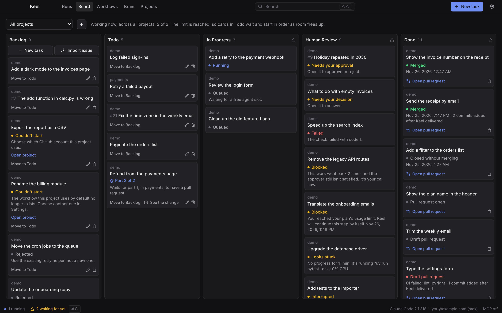

<p align="center">
  
</p>

<h1 align="center">Keel</h1>

<p align="center">
  <strong>A local software factory on top of Claude Code.</strong><br>
  You define the workflow. Agents do the work in a sandbox. A person decides what ships.
</p>

<p align="center"></p>

## Why Keel

[Claude Code](https://claude.com/product/claude-code) can write a change on its own. What it
doesn't give you is a reason to trust that change: what it was asked, what it decided by itself,
what proves it works, and who looked at it.

Keel runs each request through a workflow you choose, with the model you pick for each step. Every
run works in its own private copy of the repo, in a sandbox that can't read your home folder or
your credentials. You see what each step did, and Keel keeps an audit record you can check. Nothing
leaves your Mac until you approve it, and then it's a draft pull request. Keel never merges.

It's an app on your Mac, with no account and no server. It uses your own signed-in `claude` and
`gh`, and never stores a credential.

## How a run goes

1. **A request.** A card on the board, a GitHub issue, or an assistant over MCP.
2. **What it will change.** An agent writes down what was asked, the limits, and what it decided
   by itself. If something can only be decided by you, the run stops and asks. It recommends an
   option only when the code or the request backs one up. When nothing does, such as an amount or a
   business rule, it recommends none and you choose.
3. **The work.** A builder does it, and the project's check runs. If the check fails, the work goes
   back to the builder with what it printed.
4. **What proves it.** An agent goes through what was asked and says what a test really proves and
   what nothing does.
5. **The reviews.** Reviewers look at the change at the same time: security and code always, and
   UX, UI and state when the change calls for them. What they find is fixed before an approver decides, and the check runs again. The approver
   can send the work back too. A run goes back at most twice on its own, and after that you decide.
6. **You.** You see what was asked, what changed, what proves it and what the reviews said. You can
   change anything it decided on its own, which sends the work back without starting over. Approve,
   and Keel opens a draft pull request.
7. **After.** Keel follows the pull request until it's merged or closed. A failed CI, a conflict, or
   a review from someone who can write to the repo sends the work back as a new round, and you
   approve what comes of it before anything is pushed.

That's the built-in *Full, with reviews*. *Simple, without reviews* goes from the check straight to
you, and every workflow can be changed.

## Features

### Workflows
- **Three built in:** *Full, with reviews*, *Simple, without reviews*, and
  [*Fits the change*](#a-workflow-that-fits-the-change), which skips the reviews when a change is
  small.
- **Each project edits its own** in the app: the steps, which run at the same time, the model for
  each one, a stronger one when the change is risky, and where work goes back to. Saving a built-in makes a copy for that project.
- **Compared with what happened.** The **Workflows** page shows, for each workflow, what got merged,
  at what cost, how often work went back, and how often a run stopped to ask. It also says how many
  were merged as Keel delivered them, with no commit added afterwards.

### The board
- **Every project's cards on one board**, from Backlog to Done. Cards in Todo start on their own, in
  order, as room frees up.
- **GitHub issues come in by themselves.** Name a label, and Keel brings the open issues that have
  it to the Backlog. It never starts them on its own, and it comments on the issue when its run
  starts and when its pull request opens.
- **Changes across several projects.** One run agrees what changes in each project and in what
  order. Once you approve that, each part opens in its own project, in turn.
- **macOS notifications** while Keel isn't in front: something waits for you, a run finished, or a
  pull request was merged, closed, or its CI failed. A click opens what it's about.

### The Brain
- Each project has a small **Brain** that every agent gets: a map of the code, the decisions you
  gave when approving or rejecting, and what runs learned. [More below](#the-brain-1).
- Agents also get the repo's own `CLAUDE.md` and `.claude/rules`.

### Isolation
- A private clone per run. Your repo isn't touched.
- No home folder, no credentials, and no network beyond the domains a project allows.
  [How it isolates agents](#how-it-isolates-agents).
- Known secrets are hidden in everything Keel shows. [What it hides](#secrets-in-what-it-shows).

### Work with an assistant
- **An [MCP](#connect-an-assistant-over-mcp) server built in.** Claude Code or any MCP client can
  see your projects, start runs and tasks, wait on them, and read what each one did, while you watch
  them in the app.
- **It can't decide for you.** Approving, answering a run's questions, merging, changing settings
  and accepting anything into the Brain stay in the app.

## A workflow that fits the change

The built-in **Fits the change** skips the reviews and the approver when a change is small. Keel
decides that itself from what it can see, and an agent or an issue saying so doesn't make it so:

- What was asked was worked out as small, with no risks named, such as money or personal data.
- The project's check passed, on this code. With no check, nothing is ever small.
- The check never failed on the way. Once it has sent the work back, the reviews look at how it
  was made to pass.
- The run doesn't come from an issue by anyone other than the project's GitHub account, or from an
  assistant over MCP.
- The change touches nothing sensitive: `.github/`, build and dependency files, test settings,
  migrations, SQL schema, sign-in and permissions, secrets, environment files, lock files, and
  whatever else a project lists in **Settings**.
- The change is under 400 lines.
- The check against what was asked found nothing missing.

Your approval, the sandbox and the check are never skipped. The approval says what didn't run and
why, with a button to run it now. Once a change gets the full review, it keeps getting it for the rest
of the run. This workflow isn't the default: you choose it.

## The Brain

Each project has a small Brain, kept in the app on this Mac, and every agent gets it. It holds at
most about 4 KB, so when it's full, adding something means retiring something.

- **Map:** an agent writes it from the code when you add the project. Each line cites files and a
  commit, and it's marked out of date when those files change. When half the lines are, Keel has
  it written again as the next run starts.
- **Decisions:** what you say when approving or rejecting a change. Agents follow these first.
- **Learned:** at the end of a run, an agent can propose up to 3 things it learned, with evidence.
  They only go in if you accept them.

Agents also get the repo's own rules. The `CLAUDE.md` at the top goes to every agent whole, and a
`CLAUDE.md` in a folder or a file under `.claude/rules` is named, for the agent to read when it works
on that part. They are read as the project had them when the run started, so what a step writes in
one of them is part of the change and reaches no agent as a rule until you merge it.

## How it isolates agents

- Each run works in its own private clone. Your repo isn't touched. Keel frees the clone 7 days
  after the run ended, once its pull request is merged or closed, or, with no pull request, if
  you rejected, left or closed the run, or it changed nothing. A run that ended with changes and
  no pull request keeps its clone. The audit record stays.
- Agents can't read your home folder, including your credentials, or reach the network
  beyond the domains a project allows. [`docs/m0-report.md`](docs/m0-report.md) has the tests
  behind this.
- Keel uses your own signed-in `claude` and `gh`, and never stores a credential. Agents never
  get GitHub access: Keel pushes the branch and opens the pull request itself, as a draft. It
  doesn't merge.
- Git would run whatever a repo's `.git/config` names, so no step can change that file or the
  hooks, and everything Keel runs with git on a run's copy goes in the same sandbox.
- Services a project needs, like a test database, run outside the sandbox while a step uses
  them, and commands reach them only through a Unix socket.
- Localhost is closed as well. A project whose tests start their own servers can open it to its
  check and its builder's commands, and then they can reach any service on your Mac. Keel
  proposes it for a Gradle project, since Gradle talks to its own processes there. Setup stays
  closed, and the approval says when a run had it open.
- A setup command installs dependencies once per run, before any agent. It's the one step with
  internet access and the only one that fills the project's cache shared by its runs, and it
  still can't reach your home folder or anything else on your Mac. A setup that runs after an
  agent that can edit files or run commands, like a retry with the project's new setup, gets no
  more than a check: no network, and the run's own copy of the project's home instead of the
  project's. An agent that only reads, such as a spec, doesn't count.
- Setup, the check and the agents' commands run in a home folder of the project's own. Setup fills
  it with whatever its tools download, and each run works in a copy of it, so no step can change
  what the next run gets. Toolchains such as rustup's stay in your home folder, where they can only
  be read. Claude Code itself keeps your home folder, where your login is.
- A project's commands can read only the folders of your home folder it lists. When you set up a
  project, Keel asks your shell where the programs its commands use are, such as `~/.nvm` or
  `~/.cargo/bin`, and proposes those folders for you to confirm. It runs nothing from the repo to
  find them, and never proposes a folder with credentials in it.

## Secrets in what it shows

Keel hides known secrets when it shows a run, when an assistant reads one over MCP, in a pull
request's title and description, and in its own error log. The audit record and what agents receive
keep the original. A project's commands show whole in its settings, and so does what an assistant
set or changed in them, so you can see all of what runs.

It goes by known token shapes and names like `API_KEY`, so some secrets will slip through. It also
doesn't stop a secret an agent committed from being pushed with the branch, so review the draft
before merging.

## Install

Download the latest `.dmg` from [Releases](https://github.com/naitsric/Keel/releases/latest) and
drag Keel to Applications.

Builds aren't notarized yet, so macOS blocks the first launch. Run this once after installing:

```sh
xattr -dr com.apple.quarantine /Applications/Keel.app
```

You need:

- macOS 13 or later, on Apple Silicon
- [Claude Code](https://claude.com/product/claude-code), signed in
- Git
- [GitHub CLI](https://cli.github.com), signed in. The built-in workflows end in a pull request, so
  they need it. Without it, only a single step or a custom workflow with no delivery can run.

The first screen checks these and says how to get what's missing.

Runs spend your own Claude usage. When a step reaches your plan's limit and the limit says when it
resets, Keel continues the step by itself after that, up to three times.

## Connect an assistant over MCP

Keel has a built-in [MCP](https://modelcontextprotocol.io) server, so an assistant can see your
projects and start runs while you watch them in the app. It listens on `127.0.0.1:7413`, so only
this Mac can reach it, and it's off until you turn it on.

1. In **Settings → MCP server**, turn it on.
2. Press **Connect Claude Code**. A new Claude Code session sees it on its own. In one that's
   already open, run `/mcp`.

For another client, create a token there and give it the URL and the header it shows, once.
Connecting stores the token in Claude Code's own configuration, `~/.claude.json`, as it does for any
MCP server.

| What it can do                                         | Tools |
| ------------------------------------------------------ | ----- |
| See projects, workflows, runs, issues and the Brain    | `list_projects`, `list_workflows`, `list_runs`, `get_run`, `get_step`, `list_issues`, `get_brain` |
| Start work, and wait on it                             | `start_run`, `start_task`, `propose_change`, `wait_for_run` |
| Stop, close or start again the runs it started         | `stop_run`, `close_run`, `move_card_to_todo` |
| Give feedback, if you let it                           | `send_back`, `retry_step`, `append_to_card` |
| Propose, for you to accept                             | `draft_workflow`, `propose_project` |
| Add and configure projects, if you let it              | `add_project`, `configure_project` |

**It can't decide for you.** A client can't approve or reject a step, answer a step's questions,
merge, remove a project, save a workflow or accept anything into the Brain: a run that needs you
waits for you in the app. Nor can it change settings, apart from a project's GitHub account and
commands if you let it, as below. Whether it can start runs, whether it can give feedback, and
whether it can add and configure projects, you allow for each client, and no client can change that.
**Settings** shows every call, and revoking a client cuts it off at once.

**A client you trust can add and configure projects.** The permission is off until you turn it on
for that client, and needs the one to start runs. With it, a client can add a repository on your
Mac, from its path or from a proposal, and set a project's GitHub account and its setup and check
commands, which run on your Mac, the setup one with internet access as every setup has. Adding one starts the agent that maps it, on your Claude usage.
The network, folders, services, variables, default workflow and sensitive paths of a project stay
yours. **Settings** shows which client added or changed what, with each value before and after.

**It hands out work like an assistant hands it to helpers.** It splits a request into runs, and into
read-only tasks that only look into something, waits on several at once, and reads what each one
did. Each client can keep 3 runs open at a time, counting those that wait for you, and you can change
that for it in **Settings**, up to 10. A client frees a place by closing a run it started and won't
take further, such as one that failed: nothing is delivered, and its card goes back to the Backlog.
If you let it give feedback, it can send work back with instructions when it reaches your approval,
and retry a step that failed or stopped. The run says which client did it.

**What it proposes waits for you.** A workflow a client proposes is a draft on the **Workflows**
page. It shows the commands it would run, the agents that could change files, and any work that
would happen after your approval. Nothing can run it until you save it, you can change it first,
and saving always creates a new workflow rather than replacing one. A project a client proposes
waits in a bar at the top of the window, with its folder and GitHub repository. It isn't added, and
nothing can run on it, until you add it and choose its account and commands, or a client you let add
projects adds it. All a proposal names is the folder.

## If something goes wrong

Keel writes down what fails with nowhere to show it, such as a step whose result couldn't be saved,
and what it was doing if it closes on its own. That goes in `keel.log`, in
`~/Library/Application Support/io.github.naitsric.keel`, and **Navigate → Show Keel's error log in
Finder** takes you to it. The file stays under 1 MB, with one older file next to it.

If Keel can't open its data when it starts, it says why and closes. It won't open data that a newer
Keel has used, because it would damage it, and it leaves that data as it was.

## Status

Version 0.3, early, for macOS 13 or later on Apple Silicon. The app is in English and Spanish.

Not there yet: notarized builds and automatic updates. Linux hasn't been tried.

## Contributing

Keel is built with Tauri 2, React and Rust. See [CONTRIBUTING.md](CONTRIBUTING.md) to run it from
source, run the tests and find your way around the code. To report a vulnerability, see
[SECURITY.md](SECURITY.md).

## License

[Apache-2.0](LICENSE). Keel is an independent project, not affiliated with or endorsed by Anthropic.
